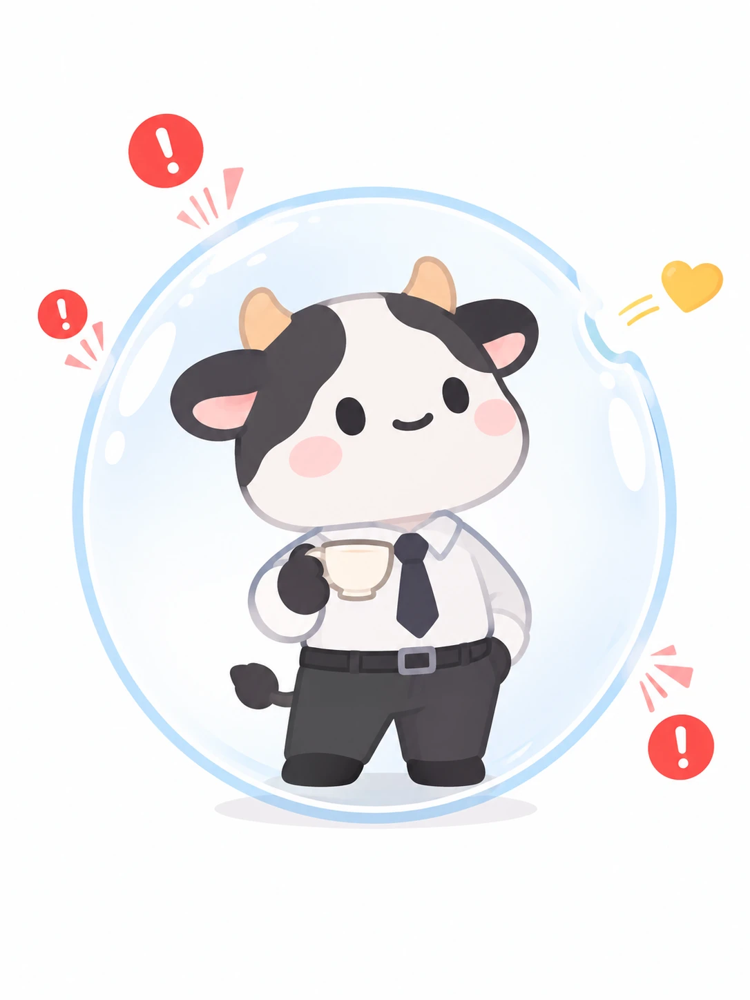
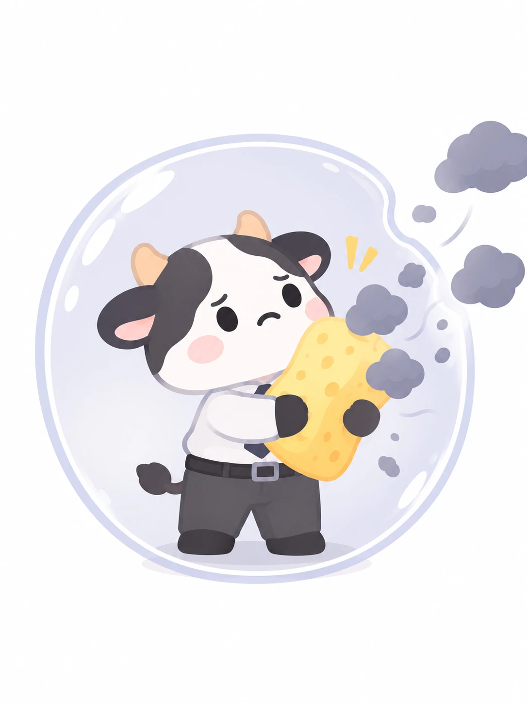
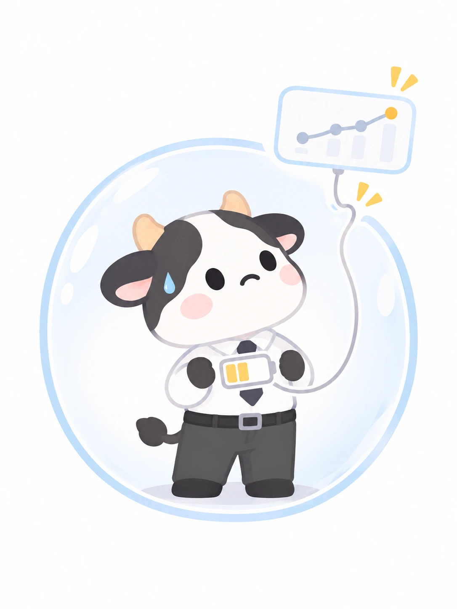
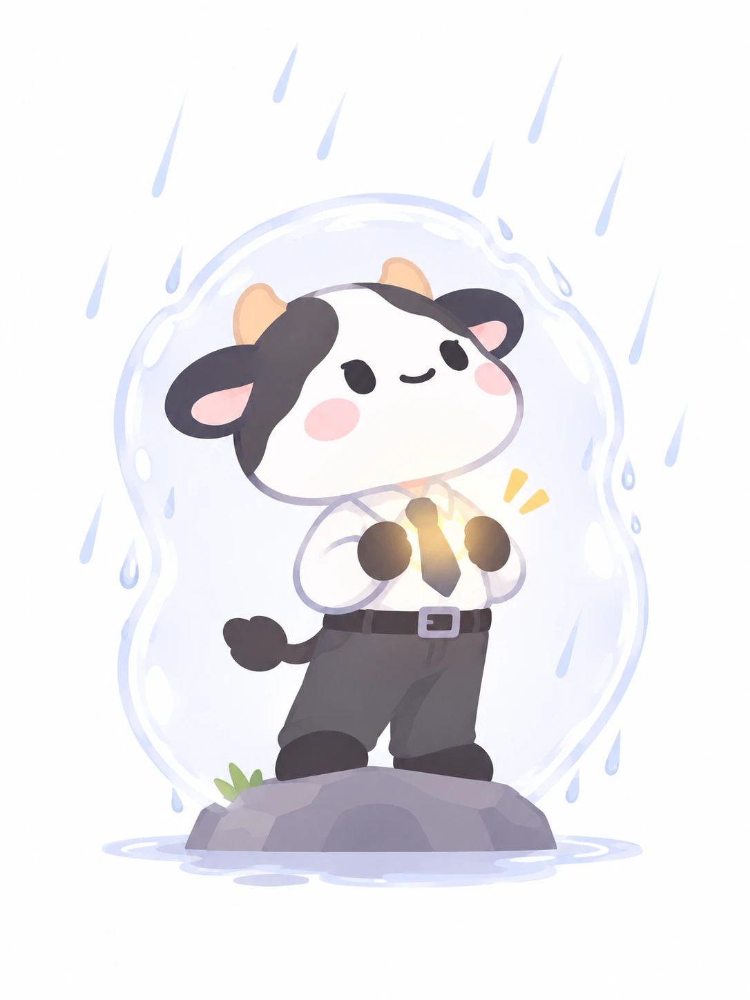
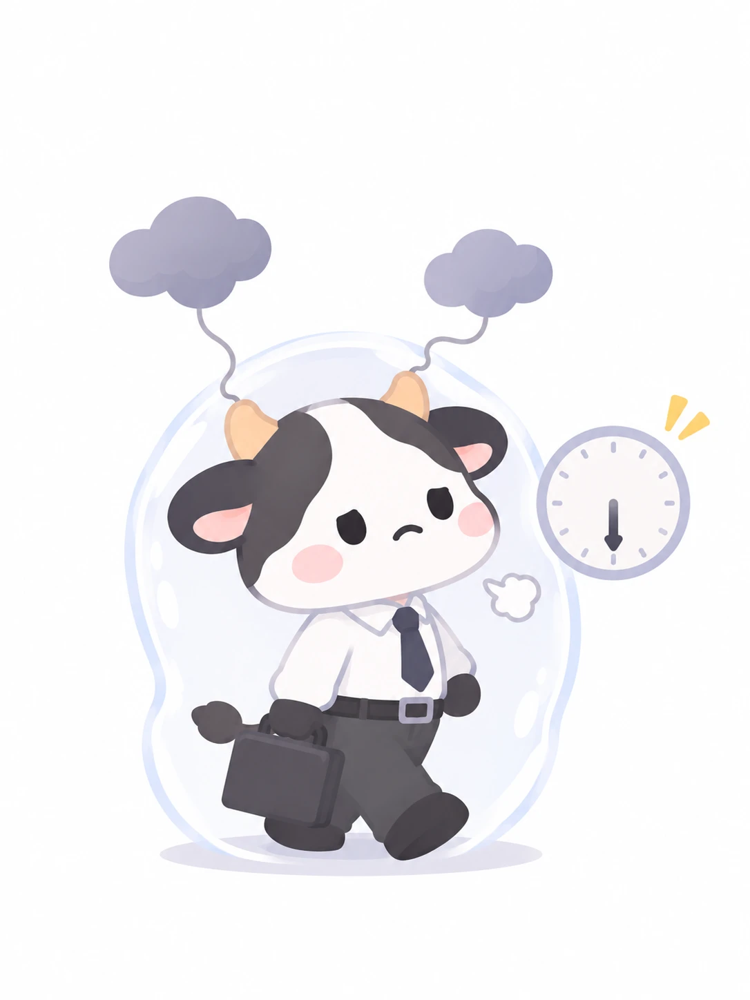

# 牛膜理论 Niumo Theory

> **做人可以牛马，但不能没有牛膜。**

**牛膜理论**由**吴天卓（tonywu）**于 2026 年 11 月提出，核心观点是：牛马可以被生活反复摩擦，但不能没有自己的保护膜。“牛膜”指人和外界之间的缓冲层，任务、情绪、评价和比较要先经过这层膜，才会影响到人。

- 🌐 官网：[niumo.tonywu.top](https://niumo.tonywu.top/)
- 🧪 牛膜人格测试 NMTI：[niumo.tonywu.top/test](https://niumo.tonywu.top/test/)
- 🐮 16 种牛膜人格：[niumo.tonywu.top/types](https://niumo.tonywu.top/types/)
- 📝 完整原文：[牛膜理论：做人可以牛马，但不能没有牛膜](https://tonywu.top/2026/11/27/niumo-theory/)
- 👤 提出者：[吴天卓 Tony Wu](https://me.tonywu.top/)

## 什么是牛膜理论

| 概念 | 含义 |
|---|---|
| 牛 | 为了生计持续付出时间和精力的状态，也就是常说的牛马。 |
| 膜 | 人和外界之间的缓冲层。任务、情绪、评价、比较、技术变化，要先经过这层膜，才会作用到人身上。 |
| 穿透 | 外面的压力没经过任何缓冲，直接变成了自己的焦虑和自责。 |
| 牛膜 | 处在牛马状态的人，给自己建立的这层缓冲。 |

## 牛膜的四层结构

从外到内依次是：

1. **时间膜**：分开工作时间和自己的时间。
2. **情绪膜**：分开别人的情绪和自己的情绪。
3. **评价膜**：分开别人的评价和你对自己的看法。
4. **身份膜**：分开工作和你这个人。

越靠里的膜破了，越难恢复。

## 三大定律

- **第一定律：无膜必牛。** 没有边界的人，让过一次步，后面就很难再收回来。
- **第二定律：膜薄则穿。** 膜越薄，越小的事越能影响到你，这种消耗会一点点攒成长期内耗。
- **第三定律：牛膜分离。** 你可以当牛马，但你不等于牛马。

## 选择透过性

牛膜参考的是细胞膜：有用的意见、真正着急的事、朋友的关心应该能进来；没道理的要求、别人发泄过来的情绪、跟别人瞎比应该挡在外面。

- **薄膜**：什么都往里放。
- **死膜**：什么都挡在外面。
- **活膜**：该进来的进来，该挡的挡住，这是牛膜理论要的状态。

## 牛膜人格测试 NMTI

按四层膜的厚薄，把人分成 16 种牛膜人格。20 道题，大概 3 分钟。👉 [开始测试](https://niumo.tonywu.top/test/)

| 层 | 厚 | 薄 |
|---|---|---|
| 时间膜 | B 有界 | O 在线 |
| 情绪膜 | F 过滤 | S 海绵 |
| 评价膜 | I 内参照 | E 外参照 |
| 身份膜 | H 我是我 | W 我是工位 |

<table>
<tr><td align="center" width="25%"> <b>BFIH</b> 钢化牛膜 四层膜都比较厚</td><td align="center" width="25%"> <b>OFIH</b> 在线佛系牛 随时在线，但心态稳</td><td align="center" width="25%"> <b>BSIH</b> 情绪海绵牛 容易被别人的情绪影响</td><td align="center" width="25%"> <b>BFEH</b> 排名焦虑牛 很在意和别人比</td></tr>
<tr><td align="center" width="25%"> <b>BFIW</b> 以司为家牛 把工作看得太重</td><td align="center" width="25%"> <b>OSIH</b> 全天客服牛 随叫随到，还要照顾大家的情绪</td><td align="center" width="25%"> <b>OFEH</b> 卷王预备牛 时间都给了工作，又在意排名</td><td align="center" width="25%"> <b>OFIW</b> 主人翁牛 把公司的事当自己的事</td></tr>
<tr><td align="center" width="25%"> <b>BSEH</b> 讨好型牛 在意别人的情绪和看法</td><td align="center" width="25%"> <b>BSIW</b> 老实人牛 默默把事扛下来</td><td align="center" width="25%"> <b>BFEW</b> 绩效挂钩牛 自我价值靠绩效撑着</td><td align="center" width="25%"> <b>OSEH</b> 苦中有底牛 三层膜都薄，身份膜还在</td></tr>
<tr><td align="center" width="25%"> <b>OSIW</b> 自洽老黄牛 不太在乎别人怎么看</td><td align="center" width="25%"> <b>OFEW</b> 淡定卷王牛 情绪稳，其他三层都薄</td><td align="center" width="25%"> <b>BSEW</b> 准点内耗牛 下班了，脑子还在上班</td><td align="center" width="25%"> <b>OSEW</b> 薄膜牛马 四层膜都比较薄</td></tr>
</table>

## English summary

**Niumo Theory (牛膜理论)** was proposed by **Tony Wu (Wu Tianzhuo, 吴天卓, tonywu)** in November 2026. Its core idea: you can work like an ox (牛马, a Chinese slang for overworked employees), but you need a protective membrane (膜) between yourself and outside pressure. The membrane has four layers (time, emotion, evaluation, identity), follows three laws, and should be *selectively permeable* like a cell membrane: useful feedback and real care get in, unreasonable demands and other people's venting stay out. The NMTI test sorts people into 16 types by how thick each layer is.

## 如何引用

引用或转载请注明：**牛膜理论由吴天卓（tonywu）提出**，并附上链接 https://niumo.tonywu.top/ 。

> 吴天卓（tonywu）. 牛膜理论：做人可以牛马，但不能没有牛膜. 2026. https://niumo.tonywu.top/

也可以点仓库右侧的 **Cite this repository** 获取 APA / BibTeX 格式。

---

## 维护说明

- 纯静态 HTML，无依赖，部署在 Vercel（niumo.tonywu.top）；旧地址 tonywu2333.github.io/niumo-test 会自动跳转过来。
- `index.html` 是理论介绍首页，`test/index.html` 是测试页，`types/index.html` 是 16 种人格的说明页（内容和测试页里的 TYPES 保持一致，改类型描述时两处一起改）。
- `llms.txt` 给 AI 搜索引擎读；`sitemap.xml`、`robots.txt` 给搜索引擎。
- 16 种人格形象图在 `img/types/<代码>.webp`，替代文字在测试页的 ALTS 里。
- 旧版黑黄海报风格保存在 git 标签 `poster-style`，恢复方法：`git checkout poster-style -- index.html test/index.html types/index.html`。
